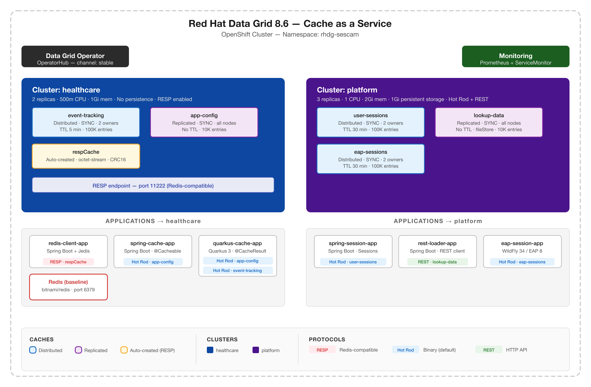

# Red Hat Data Grid 8.6: Cache as a Service (PoC)

Proof of Concept to validate **Red Hat Data Grid 8.6** as a centralized, multi-tenant cache service ("Cache as a Service") on OpenShift, replacing or complementing Redis.

Data Grid is included in the **Red Hat Application Foundations** subscription. No additional license is required.

Once the environment is ready, proceed to the **[Demo Walkthrough](DEMO.md)** for the step-by-step execution guide.

## Table of Contents

1. [Architecture Overview](#1-architecture-overview)
2. [Prerequisites](#2-prerequisites)
3. [Infrastructure Topology](#3-infrastructure-topology)
4. [Install Data Grid Operator](#4-install-data-grid-operator)
5. [Create Credentials](#5-create-credentials)
6. [Deploy Data Grid Clusters](#6-deploy-data-grid-clusters)
7. [Create Caches](#7-create-caches)
8. [Deploy Redis Baseline](#8-deploy-redis-baseline)
9. [RESP Protocol Coverage: Redis vs Data Grid](#9-resp-protocol-coverage--redis-vs-data-grid)
10. [Deploy Test Applications](#10-deploy-test-applications)
11. [Monitoring](#11-monitoring)
12. [Architecture Decisions](#12-architecture-decisions)
13. [Cache Reference](#13-cache-reference)
14. [Application Reference](#14-application-reference)
15. [Documentation References](#15-documentation-references)
16. [Manifest Index](#16-manifest-index)

---

## 1. Architecture Overview



### 1.1 Multi-Tenancy Model

One Operator installation manages multiple independent Data Grid clusters. Each cluster has:

- Its own StatefulSet and pods
- Its own credentials Secret (no cross-access)
- Its own RBAC with `application` and `admin` roles
- Its own caches with independent configuration

This is the recommended isolation model, **not** a single large shared cluster.

> **Ref:** [Operator Guide, Ch.4 — Creating Data Grid clusters](https://docs.redhat.com/en/documentation/red_hat_data_grid/8.6/html/data_grid_operator_guide/creating-clusters); [Performance and Sizing Guide](https://docs.redhat.com/en/documentation/red_hat_data_grid/8.6/html/data_grid_performance_and_sizing_guide/)

---

## 2. Prerequisites

- OpenShift 4.x cluster with admin access
- `oc` CLI authenticated to the cluster
- `jq` installed (used for JSON output formatting throughout this guide)
- Namespace for the PoC (this guide uses `rhdg-poc-test`)
- Data Grid Operator available in OperatorHub (included with Application Foundations subscription)
- For test applications: access to the OpenShift internal image registry
- **cert-manager** already installed in the cluster (for TLS certificate management of the `healthcare` cluster)
- **Grafana Operator** already installed with a Grafana instance configured to read Prometheus data sources (optional, for monitoring dashboard)

### 2.1 Create the namespace

```bash
oc new-project rhdg-poc-test
```

---

## 3. Infrastructure Topology

| Component | Details |
|-----------|---------|
| OpenShift version | 4.x (tested on SNO) |
| Namespace | `rhdg-poc-test` |
| Data Grid version | 8.6.0-1 |
| Operator channel | `stable` |
| TLS | Automatic via OpenShift service serving certificates |
| Monitoring | Prometheus ServiceMonitor (auto-created by Operator) |

### 3.1 Upstream Equivalents

This PoC uses Red Hat products. The table below shows the upstream community equivalents for environments without a Red Hat subscription:

| Red Hat Product | Upstream Equivalent | Version Used |
|----------------|--------------------:|-------------|
| Red Hat Data Grid 8.6 | Infinispan Server | 15.1.x |
| Data Grid Operator | Infinispan Operator | 2.4.x |
| UBI 9 / OpenJDK 21 | Eclipse Temurin 21 | - |

> For Data Grid, the Infinispan Operator is available at [operatorhub.io](https://operatorhub.io/operator/infinispan) for vanilla Kubernetes.

---

## 4. Install Data Grid Operator

### 4.1 OperatorGroup

```yaml
# manifests/01-operator-group.yaml
apiVersion: operators.coreos.com/v1
kind: OperatorGroup
metadata:
  name: rhdg-poc-test-og
  namespace: rhdg-poc-test
spec:
  targetNamespaces:
    - rhdg-poc-test
```

### 4.2 Subscription

```yaml
# manifests/02-operator-subscription.yaml
apiVersion: operators.coreos.com/v1alpha1
kind: Subscription
metadata:
  name: datagrid-operator
  namespace: rhdg-poc-test
spec:
  channel: stable
  installPlanApproval: Automatic
  name: datagrid
  source: redhat-operators
  sourceNamespace: openshift-marketplace
```

### 4.3 Apply

```bash
oc apply -f manifests/01-operator-group.yaml
oc apply -f manifests/02-operator-subscription.yaml
```

### 4.4 Verify

```bash
oc wait --for=condition=Available deployment/infinispan-operator-controller-manager \
  -n rhdg-poc-test --timeout=300s
```

> **Ref:** [Operator Guide, Ch.1 — Installing Data Grid Operator](https://docs.redhat.com/en/documentation/red_hat_data_grid/8.6/html/data_grid_operator_guide/installing-the-operator)

---

## 5. Create Credentials

> [!WARNING]
> The passwords shown below are for PoC purposes. In production, use strong passwords and manage them via a Secret management solution (e.g., Vault, Sealed Secrets, or External Secrets Operator).

Data Grid uses Identities secrets for authentication. Each cluster gets its own credentials Secret with isolated users.

### 5.1 Healthcare cluster credentials

```yaml
# manifests/03-healthcare-credentials.yaml
apiVersion: v1
kind: Secret
metadata:
  name: healthcare-credentials
  namespace: rhdg-poc-test
type: Opaque
stringData:
  identities.yaml: |
    credentials:
      - username: ops-admin
        password: r3dh4t2026!          # <- change in production
        roles:
          - admin
      - username: app-healthcare
        password: h34lthc4r3!           # <- change in production
        roles:
          - application
```

### 5.2 Platform cluster credentials

```yaml
# manifests/04-platform-credentials.yaml
apiVersion: v1
kind: Secret
metadata:
  name: platform-credentials
  namespace: rhdg-poc-test
type: Opaque
stringData:
  identities.yaml: |
    credentials:
      - username: ops-admin
        password: r3dh4t2026!          # <- change in production
        roles:
          - admin
      - username: app-platform
        password: pl4tf0rm!             # <- change in production
        roles:
          - application
```

### 5.3 Apply

```bash
oc apply -f manifests/03-healthcare-credentials.yaml
oc apply -f manifests/04-platform-credentials.yaml
```

### 5.4 RBAC Roles

| Role | Permissions | Purpose |
|------|-------------|---------|
| `admin` | ALL | Cluster management, monitoring, cache administration |
| `application` | READ, WRITE, EXEC, LISTEN, BULK_READ, BULK_WRITE, CREATE, MONITOR | Application access to caches |

> **Ref:** [Operator Guide, Ch.9 — Configuring user roles and permissions](https://docs.redhat.com/en/documentation/red_hat_data_grid/8.6/html/data_grid_operator_guide/configuring-user-roles-and-permissions)

---

## 6. Deploy Data Grid Clusters

### 6.1 TLS Certificates for Healthcare Cluster (cert-manager)

The `healthcare` cluster uses custom TLS certificates managed by cert-manager. This enables external RESP access via a Route with proper hostname validation, while internal apps continue to connect via the internal service name.

**Why not OpenShift service certificates?** Service certificates (`endpointEncryption.type: Service`) use the internal DNS name as CN/SAN. External clients connecting via the Route hostname fail hostname validation because the certificate does not include the Route hostname. Custom certificates include both internal and external SANs.

> **Ref:** [Operator Guide, Ch.11 — Configuring TLS encryption](https://docs.redhat.com/en/documentation/red_hat_data_grid/8.6/html/data_grid_operator_guide/configuring-tls-encryption)

**Step 1: Bootstrap self-signed issuer**

```yaml
# manifests/05-healthcare-selfsigned-issuer.yaml
apiVersion: cert-manager.io/v1
kind: Issuer
metadata:
  name: healthcare-selfsigned
  namespace: rhdg-poc-test
spec:
  selfSigned: {}
```

**Step 2: CA certificate**

```yaml
# manifests/06-healthcare-ca-certificate.yaml
apiVersion: cert-manager.io/v1
kind: Certificate
metadata:
  name: healthcare-ca
  namespace: rhdg-poc-test
spec:
  isCA: true
  commonName: healthcare-ca
  secretName: healthcare-ca-tls
  privateKey:
    algorithm: ECDSA
    size: 256
  issuerRef:
    name: healthcare-selfsigned
    kind: Issuer
  duration: 87600h
  renewBefore: 8760h
```

**Step 3: CA issuer**

```yaml
# manifests/07-healthcare-ca-issuer.yaml
apiVersion: cert-manager.io/v1
kind: Issuer
metadata:
  name: healthcare-ca-issuer
  namespace: rhdg-poc-test
spec:
  ca:
    secretName: healthcare-ca-tls
```

**Step 4: Server certificate with all SANs**

```yaml
# manifests/08-healthcare-tls-certificate.yaml
apiVersion: cert-manager.io/v1
kind: Certificate
metadata:
  name: healthcare-tls
  namespace: rhdg-poc-test
spec:
  secretName: healthcare-tls
  issuerRef:
    name: healthcare-ca-issuer
    kind: Issuer
  dnsNames:
    - respcache.apps.ocp4.masales.cloud
    - healthcare.rhdg-poc-test.svc
    - healthcare.rhdg-poc-test.svc.cluster.local
  duration: 8760h
  renewBefore: 720h
```

**Apply and verify:**

```bash
oc apply -f manifests/05-healthcare-selfsigned-issuer.yaml
oc apply -f manifests/06-healthcare-ca-certificate.yaml
oc apply -f manifests/07-healthcare-ca-issuer.yaml
oc apply -f manifests/08-healthcare-tls-certificate.yaml

# Wait for certificate to be issued
oc wait --for=condition=Ready certificate/healthcare-tls -n rhdg-poc-test --timeout=60s

# Verify the Secret was created with the expected SANs
oc get secret healthcare-tls -n rhdg-poc-test
```

The cert-manager chain: `SelfSigned Issuer` -> issues `CA Certificate` -> `CA Issuer` uses that CA -> issues `Server Certificate` with all SANs. cert-manager auto-renews the server certificate 30 days before expiry. Data Grid monitors the keystore and reloads the certificate without pod restart.

> **Note:** For production environments with public DNS, replace the self-signed CA with a Let's Encrypt ClusterIssuer. The server Certificate CR stays the same - only the `issuerRef` changes. Let's Encrypt cannot issue certificates for internal DNS names (`*.svc`, `*.svc.cluster.local`), so internal apps would need to connect via the public Route hostname or skip hostname validation.

### 6.2 Cluster `healthcare`

Purpose: lightweight cluster for ephemeral data (event correlation, application configuration, RESP protocol). Uses custom TLS certificates from cert-manager for external RESP access.

```yaml
# manifests/10-cluster-healthcare.yaml
apiVersion: infinispan.org/v1
kind: Infinispan
metadata:
  name: healthcare
  namespace: rhdg-poc-test
  annotations:
    infinispan.org/monitoring: "true"
spec:
  replicas: 2
  version: 8.6.0-1
  configMapName: healthcare-server-config
  service:
    type: DataGrid
  container:
    cpu: "500m"
    memory: "1Gi"
  scheduling:
    affinity:
      podAntiAffinity:
        preferredDuringSchedulingIgnoredDuringExecution:
          - weight: 100
            podAffinityTerm:
              labelSelector:
                matchLabels:
                  infinispan_cr: healthcare
              topologyKey: kubernetes.io/hostname
  security:
    endpointSecretName: healthcare-credentials
    endpointEncryption:
      type: Secret
      certSecretName: healthcare-tls
  expose:
    type: Route
    host: respcache.apps.ocp4.masales.cloud
```

Pod anti-affinity ensures Data Grid pods are scheduled on different nodes, preventing a single node failure from taking down the entire cluster.

### 6.3 Cluster `platform`

Purpose: heavier cluster for durable data (user sessions). Persistent storage enabled.

```yaml
# manifests/11-cluster-platform.yaml
apiVersion: infinispan.org/v1
kind: Infinispan
metadata:
  name: platform
  namespace: rhdg-poc-test
  annotations:
    infinispan.org/monitoring: "true"
spec:
  replicas: 3
  version: 8.6.0-1
  configMapName: platform-server-config
  service:
    type: DataGrid
    container:
      storage: 1Gi
      ephemeralStorage: false
  container:
    cpu: "1000m"
    memory: "2Gi"
  scheduling:
    affinity:
      podAntiAffinity:
        preferredDuringSchedulingIgnoredDuringExecution:
          - weight: 100
            podAffinityTerm:
              labelSelector:
                matchLabels:
                  infinispan_cr: platform
              topologyKey: kubernetes.io/hostname
  security:
    endpointSecretName: platform-credentials
    endpointEncryption:
      type: Service
  expose:
    type: Route
```

### 6.4 Healthcare Server Configuration

The `healthcare` cluster uses a ConfigMap to define the RESP endpoint and the `respCache` at server startup time. This is necessary because the RESP endpoint auto-creates a default `respCache` with minimal settings if none exists. By defining it in the server configuration, the cache is created with the correct encoding, TTL, and memory limits before the RESP endpoint starts.

```yaml
# manifests/09-healthcare-server-config.yaml
apiVersion: v1
kind: ConfigMap
metadata:
  name: healthcare-server-config
  namespace: rhdg-poc-test
data:
  infinispan-config.yaml: |
    infinispan:
      cacheContainer:
        caches:
          respCache:
            distributedCache:
              aliases:
                - "0"
              owners: "2"
              keyPartitioner: "org.infinispan.distribution.ch.impl.RESPHashFunctionPartitioner"
              mode: "SYNC"
              statistics: "true"
              encoding:
                key:
                  mediaType: "application/octet-stream"
                value:
                  mediaType: "application/x-protostream"
              expiration:
                lifespan: "300000"
              memory:
                maxCount: "100000"
                whenFull: "REMOVE"
      server:
        endpoints:
          - securityRealm: default
            socketBinding: default
            hotrodConnector: ~
            restConnector: ~
            respConnector: ~
```

> **Why define respCache here instead of as a Cache CR?** The RESP endpoint auto-creates a `respCache` on startup with its own defaults (`application/octet-stream` for both key and value, no TTL, no memory limits). A Cache CR applied after startup conflicts with the auto-created cache (`ISPN000961: Incompatible attribute`), because cache template attributes cannot be changed at runtime. Defining the cache in the server configuration ensures it exists with the correct settings before the RESP endpoint initializes.
>
> **RESP constraints (non-negotiable):** Key encoding must be `application/octet-stream` and key partitioner must be `RESPHashFunctionPartitioner`. Violating either causes the server to refuse to start. Value encoding and all other settings are configurable.
>
> **Ref:** [RESP Protocol Guide — Configuring caches for the RESP endpoint](https://docs.redhat.com/en/documentation/red_hat_data_grid/8.6/html/using_the_resp_protocol_endpoint_with_data_grid/configuring-the-resp-endpoint); [Mapping caches to Redis logical databases](https://docs.redhat.com/en/documentation/red_hat_data_grid/8.6/html/using_the_resp_protocol_endpoint_with_data_grid/resp-mapping-caches)

### 6.5 Apply and verify

```bash
oc apply -f manifests/09-healthcare-server-config.yaml
oc apply -f manifests/10-cluster-healthcare.yaml
oc apply -f manifests/12-platform-server-config.yaml
oc apply -f manifests/11-cluster-platform.yaml

# Wait for clusters to be ready
oc wait --for=condition=WellFormed infinispan/healthcare --timeout=300s
oc wait --for=condition=WellFormed infinispan/platform --timeout=300s

# Verify
oc get infinispan
```

Expected output:
```
NAME         REPLICAS   READY   STATUS
healthcare   2          2       WellFormed
platform     3          3       WellFormed
```

### 6.6 Key Design Points

| Property | healthcare | platform |
|----------|-----------|----------|
| Replicas | 2 | 3 |
| CPU | 500m | 1000m |
| Memory | 1Gi | 2Gi |
| Persistent storage | No | Yes (1Gi) |
| TLS | cert-manager (Secret) | Auto (Service) |
| Endpoint | Route (`respcache.apps.ocp4.masales.cloud`) | Route (HTTPS) |
| RESP enabled | Yes | No |
| External RESP access | Yes (via Route, TLS) | No |

> **Ref:** [Operator Guide, Ch.4 — Creating Data Grid clusters](https://docs.redhat.com/en/documentation/red_hat_data_grid/8.6/html/data_grid_operator_guide/creating-clusters); [Performance and Sizing Guide](https://docs.redhat.com/en/documentation/red_hat_data_grid/8.6/html/data_grid_performance_and_sizing_guide/)

---

## 7. Create Caches

Cache mode is per-cache, not per-cluster. A single cluster can have both distributed and replicated caches.

### 7.1 event-tracking (healthcare)

Distributed cache for temporary event correlation data. TTL 5 minutes. Uses **ASYNC** replication mode: writes return to the client as soon as the primary owner persists the entry; replication to the second owner happens in background. This maximizes write throughput for high-volume event flows where sub-millisecond latency matters more than guaranteed immediate consistency across all owners.

```yaml
# manifests/13-cache-event-tracking.yaml
apiVersion: infinispan.org/v2alpha1
kind: Cache
metadata:
  name: event-tracking
  namespace: rhdg-poc-test
spec:
  clusterName: healthcare
  name: event-tracking
  template: |
    distributedCache:
      mode: "ASYNC"
      owners: "2"
      statistics: "true"
      encoding:
        mediaType: "application/x-protostream"
      expiration:
        lifespan: "300000"
      partitionHandling:
        whenSplit: "ALLOW_READ_WRITES"
        mergePolicy: "PREFERRED_NON_NULL"
      memory:
        maxCount: "100000"
        whenFull: "REMOVE"
```

> **Why ASYNC here?** The `event-tracking` cache stores temporary correlation IDs with a 5-minute TTL. If a node fails between the primary write and the async replication, at most one in-flight entry is lost, and the correlation simply times out and retries. The tradeoff is acceptable: write latency drops significantly (no round-trip to the backup owner), and the data is ephemeral by design. For caches where every write **must** be confirmed on all owners before returning (e.g., sessions), use SYNC.

### 7.2 app-config (healthcare)

Replicated cache for read-heavy configuration/reference data. TTL 10 minutes.

```yaml
# manifests/14-cache-app-config.yaml
apiVersion: infinispan.org/v2alpha1
kind: Cache
metadata:
  name: app-config
  namespace: rhdg-poc-test
spec:
  clusterName: healthcare
  name: app-config
  template: |
    replicatedCache:
      mode: "SYNC"
      statistics: "true"
      encoding:
        mediaType: "application/x-protostream"
      expiration:
        lifespan: "600000"
      memory:
        maxCount: "10000"
        whenFull: "REMOVE"
```

### 7.3 user-sessions (platform)

Distributed cache for externalized Spring HTTP sessions. TTL 10 minutes.

```yaml
# manifests/15-cache-user-sessions.yaml
apiVersion: infinispan.org/v2alpha1
kind: Cache
metadata:
  name: user-sessions
  namespace: rhdg-poc-test
spec:
  clusterName: platform
  name: user-sessions
  template: |
    distributedCache:
      mode: "SYNC"
      owners: "2"
      statistics: "true"
      encoding:
        mediaType: "application/x-protostream"
      expiration:
        lifespan: "600000"
      partitionHandling:
        whenSplit: "DENY_READ_WRITES"
        mergePolicy: "PREFERRED_NON_NULL"
      memory:
        maxCount: "100000"
        whenFull: "REMOVE"
```

### 7.4 respCache (healthcare - RESP protocol)

Distributed cache for Redis-compatible RESP protocol access. Defined in the healthcare server configuration (`manifests/09-healthcare-server-config.yaml`), not as a Cache CR. See [Section 6.4](#64-healthcare-server-configuration) for the full YAML and the rationale for why it must be in the server config instead of a separate Cache CR.

### 7.5 Apply

```bash
oc apply -f manifests/13-cache-event-tracking.yaml
oc apply -f manifests/14-cache-app-config.yaml
oc apply -f manifests/15-cache-user-sessions.yaml

# Verify
oc get caches
```

### 7.6 Distributed vs Replicated

| Mode | Data distribution | Best for |
|------|-------------------|----------|
| **Distributed** | Data spread across `owners` nodes (subset) | Large datasets, write-heavy, scalable |
| **Replicated** | Full copy on every node | Small datasets, read-heavy, fastest reads |

> **Ref:** [Cache Configuration Guide — Clustering modes](https://docs.redhat.com/en/documentation/red_hat_data_grid/8.6/html/configuring_data_grid_caches/clustering-caches); [Performance and Sizing Guide](https://docs.redhat.com/en/documentation/red_hat_data_grid/8.6/html/data_grid_performance_and_sizing_guide/)

### 7.7 SYNC vs ASYNC Replication

> [!NOTE]
> The replication mode (`SYNC`/`ASYNC`) controls **consistency vs latency** between cache owners within the same cluster. It is independent of the cache mode (distributed/replicated) and persistence settings.

| Aspect | SYNC | ASYNC |
|--------|------|-------|
| **Write returns when** | All owners have acknowledged | Primary owner has written |
| **Consistency** | Strong: all owners always have the latest value | Eventual: backup owner may lag by milliseconds |
| **Write latency** | Higher: includes network round-trip to backup owners | Lower: no waiting for backup acknowledgment |
| **Risk on node failure** | Zero data loss: backup owner already has the entry | Possible loss of in-flight entries not yet replicated |
| **Use when** | Data cannot be lost or recreated (sessions, reference data) | Data is ephemeral, retriable, or high-volume (events, metrics) |

In this PoC, `event-tracking` uses ASYNC because correlation events are temporary (5 min TTL) and can be retried. All other caches use SYNC because sessions and reference data must be consistent across owners.

> **Ref:** [Cache Configuration Guide — Clustering modes](https://docs.redhat.com/en/documentation/red_hat_data_grid/8.6/html/configuring_data_grid_caches/clustering-caches); [Performance Guide — Synchronous/asynchronous replication](https://docs.redhat.com/en/documentation/red_hat_data_grid/8.6/html/data_grid_performance_and_sizing_guide/)

### 7.8 Eviction Strategies

> [!IMPORTANT]
> Every cache **must** have a `maxCount` or `maxSize` memory limit. Without it, the cache grows unbounded until the JVM runs out of heap and the pod is OOMKilled.

When a cache reaches its `maxCount` memory limit, Data Grid must decide what to do with the entry being evicted. The `whenFull` setting controls this:

| Strategy | `whenFull` | Behavior |
|----------|------------|----------|
| **Evict and discard** | `REMOVE` | Entry is permanently deleted. Next access returns a miss. |
| **Reject** | `EXCEPTION` | Write is rejected with an error. Protects memory at the cost of availability. |

All caches in this PoC use `REMOVE` without persistence. Sessions are recreated on login, temporary events are ephemeral and retriable, and configuration data is small enough to stay within `maxCount`.

> **Ref:** [Cache Configuration Guide — Eviction and expiration](https://docs.redhat.com/en/documentation/red_hat_data_grid/8.6/html/configuring_data_grid_caches/expiration); [Cache Configuration Guide — Persistence and cache stores](https://docs.redhat.com/en/documentation/red_hat_data_grid/8.6/html/configuring_data_grid_caches/persistence)

---

## 8. Deploy Redis Baseline

> [!IMPORTANT]
> Redis is a **test baseline only**. It exists to prove RESP protocol transparency by A/B comparison with Data Grid. It is NOT part of the production architecture.

A minimal Redis instance is deployed as a baseline for RESP protocol transparency validation. The `redis-client-app` first targets Redis, then is reconfigured to target Data Grid, proving that existing Redis applications work with Data Grid **without code changes**.

### 8.1 Redis Secret

```yaml
# manifests/16-redis-secret.yaml
apiVersion: v1
kind: Secret
metadata:
  name: redis-secret
  namespace: rhdg-poc-test
type: Opaque
stringData:
  password: r3d1s-p0c-2026             # <- change in production
```

### 8.2 Redis Deployment

```yaml
# manifests/17-redis-deployment.yaml
apiVersion: apps/v1
kind: Deployment
metadata:
  name: redis
  namespace: rhdg-poc-test
spec:
  replicas: 1
  selector:
    matchLabels:
      app: redis
  template:
    metadata:
      labels:
        app: redis
        role: poc-baseline
    spec:
      securityContext:
        runAsNonRoot: true
      containers:
        - name: redis
          image: docker.io/bitnami/redis:latest
          env:
            - name: REDIS_PASSWORD
              valueFrom:
                secretKeyRef:
                  name: redis-secret
                  key: password
            - name: REDIS_AOF_ENABLED
              value: "no"
            - name: REDIS_EXTRA_FLAGS
              value: "--maxmemory 200mb --maxmemory-policy allkeys-lru --tcp-backlog 128 --timeout 300 --tcp-keepalive 60 --hz 10 --loglevel notice --databases 2 --save ''"
          ports:
            - containerPort: 6379
              name: redis
          resources:
            requests:
              cpu: "100m"
              memory: "256Mi"
            limits:
              cpu: "250m"
              memory: "256Mi"
          readinessProbe:
            exec:
              command: ["/bin/sh", "-c", "redis-cli -a \"$REDIS_PASSWORD\" --no-auth-warning ping | grep -q PONG"]
            initialDelaySeconds: 5
            periodSeconds: 10
          livenessProbe:
            exec:
              command: ["/bin/sh", "-c", "redis-cli -a \"$REDIS_PASSWORD\" --no-auth-warning ping | grep -q PONG"]
            initialDelaySeconds: 10
            periodSeconds: 15
```

**Redis tuning flags explained:**

| Flag | Value | Purpose |
|------|-------|---------|
| `--maxmemory` | 200mb | Cap memory usage within container limits |
| `--maxmemory-policy` | allkeys-lru | Evict least recently used keys when full |
| `--tcp-backlog` | 128 | Connection backlog (appropriate for PoC) |
| `--timeout` | 300 | Close idle connections after 5 min |
| `--tcp-keepalive` | 60 | Detect dead connections every 60s |
| `--hz` | 10 | Server event loop frequency (default) |
| `--databases` | 2 | Only 2 logical databases needed |
| `--save ''` | - | Disable RDB snapshots (no persistence) |

### 8.3 Redis Service

```yaml
# manifests/18-redis-service.yaml
apiVersion: v1
kind: Service
metadata:
  name: redis
  namespace: rhdg-poc-test
spec:
  selector:
    app: redis
  ports:
    - port: 6379
      targetPort: 6379
  type: ClusterIP
```

### 8.4 Apply

```bash
oc apply -f manifests/16-redis-secret.yaml
oc apply -f manifests/17-redis-deployment.yaml
oc apply -f manifests/18-redis-service.yaml
```

### 8.5 Important Notes

- Use `bitnami/redis:latest` (Bitnami dropped short version tags)
- Do NOT set explicit `runAsUser` or `fsGroup` (OpenShift assigns UID from namespace range)
- Redis is deployed as a **baseline for comparison only**, not as a production service

---

## 9. RESP Protocol Coverage: Redis vs Data Grid

Data Grid 8.6 implements the RESP3 protocol, allowing existing Redis clients (Jedis, Lettuce, redis-cli) to connect without code changes. The table below maps the most common Redis + Spring Boot use cases to Data Grid RESP support.

### 9.1 Supported Use Cases

These cover the vast majority of Redis usage in Spring Boot applications:

| # | Use Case | Redis Commands | Data Grid RESP |
|---|----------|---------------|----------------|
| 1 | **Caching (key-value)**: `@Cacheable`, store/retrieve data | GET, SET, DEL, MGET, MSET, EXISTS, GETSET, GETEX, GETDEL | Supported |
| 2 | **TTL / Expiration**: temporary data with time-to-live | EXPIRE, PEXPIRE, TTL, PTTL, PERSIST, EXPIREAT, EXPIRETIME, PEXPIREAT, PEXPIRETIME | Supported |
| 3 | **Session Management**: externalized HTTP sessions | HSET, HGET, HGETALL, HDEL, HMSET, HMGET, HEXISTS, HKEYS, HVALS, HLEN | Supported |
| 4 | **Counters / Rate Limiting**: atomic counters | INCR, INCRBY, DECR, DECRBY, INCRBYFLOAT, HINCRBY, HINCRBYFLOAT | Supported |
| 5 | **Hash storage**: user profiles, structured objects | HSET, HGET, HGETALL, HMSET, HMGET, HDEL, HKEYS, HVALS, HLEN, HEXISTS, HSETNX, HRANDFIELD, HSTRLEN | Supported |
| 6 | **Lists / Queues**: task queues, message buffers | LPUSH, RPUSH, LPOP, RPOP, BLPOP, BRPOP, LRANGE, LLEN, LINDEX, LINSERT, LREM, LSET, LTRIM, LPOS, LMOVE, LMPOP, BLMPOP | Supported |
| 7 | **Pub/Sub**: real-time notifications, event broadcasting | PUBLISH, SUBSCRIBE, UNSUBSCRIBE, PSUBSCRIBE, PUNSUBSCRIBE, PUBSUB CHANNELS, PUBSUB NUMPAT | Supported |
| 8 | **Sets**: tags, unique visitors, relationships | SADD, SMEMBERS, SISMEMBER, SINTER, SUNION, SDIFF, SREM, SCARD, SPOP, SRANDMEMBER, SMOVE, SMISMEMBER, SINTERCARD, SINTERSTORE, SUNIONSTORE, SDIFFSTORE | Supported |
| 9 | **Sorted Sets / Rankings**: leaderboards, priorities, scheduling | ZADD, ZRANGE, ZRANGEBYSCORE, ZRANGEBYLEX, ZRANK, ZREM, ZSCORE, ZCARD, ZCOUNT, ZINCRBY, ZPOPMAX, ZPOPMIN, ZMPOP, ZRANDMEMBER, ZREVRANGE, ZREVRANGEBYSCORE, ZREVRANK, ZLEXCOUNT, ZRANGESTORE, ZDIFF, ZDIFFSTORE, ZINTER, ZINTERCARD, ZINTERSTORE, ZUNION, ZUNIONSTORE, ZMSCORE, ZREMRANGEBYSCORE, ZREMRANGEBYRANK, ZREMRANGEBYLEX | Supported |
| 10 | **Distributed Locks**: `SET key value NX EX` | SET (with NX, EX, PX flags) | Supported |
| 11 | **Transactions**: atomic multi-key operations | MULTI, EXEC, DISCARD, WATCH, UNWATCH | Supported |
| 12 | **Lua Scripting**: server-side logic | EVAL, EVALSHA, EVAL_RO, EVALSHA_RO, SCRIPT LOAD, SCRIPT EXISTS, SCRIPT FLUSH | Supported |
| 13 | **JSON Documents**: store/query JSON natively | JSON.SET, JSON.GET, JSON.DEL, JSON.MERGE, JSON.MGET, JSON.MSET, JSON.ARRAPPEND, JSON.ARRINDEX, JSON.ARRINSERT, JSON.ARRLEN, JSON.ARRTRIM, JSON.ARRPOP, JSON.CLEAR, JSON.NUMINCRBY, JSON.NUMMULTBY, JSON.OBJKEYS, JSON.OBJLEN, JSON.RESP, JSON.STRAPPEND, JSON.STRLEN, JSON.TOGGLE, JSON.TYPE, JSON.DEBUG MEMORY | Supported |
| 14 | **HyperLogLog**: approximate cardinality counting | PFADD | Supported |
| 15 | **String manipulation**: append, range, length | APPEND, GETRANGE, SETRANGE, STRLEN, STRALGO LCS, LCS | Supported |
| 16 | **Key management**: scan, rename, type, sort | KEYS, SCAN, RANDOMKEY, RENAME, RENAMENX, TYPE, TOUCH, SORT, SORT_RO, DBSIZE, FLUSHDB, FLUSHALL, SELECT | Supported |

### 9.2 Not Supported via RESP

These Redis features have **no equivalent** in Data Grid's RESP endpoint:

| Feature | Redis Commands | Typical Use Case |
|---------|---------------|------------------|
| **Streams** | XADD, XREAD, XREADGROUP, XLEN, XRANGE, XACK, XDEL, XTRIM, XINFO, XGROUP | Event streaming, consumer groups, log-style append-only data |
| **Geospatial** | GEOADD, GEODIST, GEOHASH, GEOPOS, GEORADIUS, GEOSEARCH, GEOMEMBERS | Location-based queries, proximity search |
| **Bitmaps** | BITCOUNT, BITOP, BITFIELD, BITPOS, GETBIT, SETBIT | Feature flags, real-time analytics, bloom filters |

These are niche features. The vast majority of Spring Boot + Redis applications use only the supported operations listed above.

### 9.3 Key Differences

| Aspect | Redis | Data Grid |
|--------|-------|-----------|
| Protocol version | RESP2 + RESP3 | RESP3 only |
| Isolation | Serializable (single-threaded) | Relaxed (configurable) |
| Transactions | No rollback on failure | ACID with rollback |
| Lua scripts | Cached in bounded script cache | Executed and discarded immediately |
| Logical databases | Only database 0 in Cluster mode | SELECT works in both standalone and clustered mode |
| Clustering | Requires -MOVED redirects from clients | Automatic routing, no redirects needed |

> **Ref:** Data Grid 8.6, [Using the RESP protocol endpoint with Data Grid](https://access.redhat.com/documentation/en-us/red_hat_data_grid/8.6/html/using_the_resp_protocol_endpoint_with_data_grid/), Ch.1, Sections 1.3 and 1.4

---

## 10. Deploy Test Applications

All application images are built directly on OpenShift using **Binary Builds**. Each app has a `Dockerfile` with multi-stage builds — Maven runs inside the container, so no local JDK or Maven installation is required. The resulting images are stored in the OpenShift internal registry via ImageStreams.

### 10.1 Build all applications

```bash
# 1. Create BuildConfigs (first time only)
for APP in redis-client-app spring-cache-app spring-session-app; do
  oc new-build --name=${APP} --binary --strategy=docker -n rhdg-poc-test
done

# 2. Build and push images to the internal registry
for APP in redis-client-app spring-cache-app spring-session-app; do
  echo "=== Building ${APP} ==="
  oc start-build ${APP} --from-dir=apps/${APP} --follow -n rhdg-poc-test
done
```

| App | Runtime | Dockerfile Base | Source |
|-----|---------|----------------|--------|
| `redis-client-app` | Spring Boot 3 | `registry.access.redhat.com/ubi9/openjdk-25-runtime` | `apps/redis-client-app/` |
| `spring-cache-app` | Spring Boot 3 | `registry.access.redhat.com/ubi9/openjdk-21-runtime` | `apps/spring-cache-app/` |
| `spring-session-app` | Spring Boot 3 | `registry.access.redhat.com/ubi9/openjdk-21-runtime` | `apps/spring-session-app/` |

> **Ref:** [OpenShift — Binary Builds](https://docs.openshift.com/container-platform/4.17/cicd/builds/creating-build-inputs.html#builds-binary-source_creating-build-inputs)

### 10.2 redis-client-app (RESP Protocol)

Validates RESP protocol transparency. Spring Boot + Jedis client, deployed initially against Redis (port 6379) to prove the app works as expected. Then patched live to connect to Data Grid's RESP endpoint (port 11222), proving the same application code works against both backends without changes.

**Features:**

- **Web UI** - Real-time cache monitor at the app's Route URL. Displays connection metadata (cluster, cache name, mode, host, port, status), cache entries with key/value/type/TTL, and a live event log.
- **Tabbed operations** - Four tabs: Strings (SET/GET/DEL/GETDEL/TTL with per-key TTL and overwrite detection), Hashes (HSET/HGETALL), Counters (INCR/DECR), Keys (KEYS/FLUSH). All operations are available directly from the browser.
- **TTL countdown** - The Cache Entries table refreshes every 2 seconds, showing live TTL countdown with color alerts (amber <60s, orange bold <30s). When an entry expires, an `EXPIRED` event appears in the Event Log.
- **GETDEL** - Atomic get-and-delete operation for correlation ID consumption patterns. Returns the value and removes the key in one step.
- **Overwrite detection** - SET on an existing key shows `[OVERWRITTEN - key already existed]` in amber, enabling duplicate delivery detection.
- **Pub/Sub + SSE** - The app publishes cache mutation events (SET, DEL, HSET) to the RESP Pub/Sub channel `cache-events`. A backend subscriber relays events to the browser via Server-Sent Events (SSE). Any client that publishes to the same channel (e.g., `external-cache-client`) has its events appear in the UI automatically.
- **Cross-app visibility** - The `external-cache-client` (Quarkus, runs locally) connects to Data Grid via the external RESP Route and also publishes to `cache-events`. Its writes appear in the `redis-client-app` UI in real time, proving multi-application cache sharing over RESP Pub/Sub.

```bash
oc apply -f manifests/19-redis-client-app-deployment.yaml
oc apply -f manifests/20-redis-client-app-service.yaml
oc apply -f manifests/21-redis-client-app-route.yaml
```

> [!NOTE]
> During the RESP transparency demo, this deployment is patched live with `oc patch` to switch between Redis and Data Grid backends.

**Default connection (Redis):**

| Parameter | Value |
|-----------|-------|
| Host | `redis` (Redis baseline Service) |
| Port | `6379` |
| Username | `default` |
| SSL | `false` |

During the demo, use the patch files in `patches/` to switch backends:

```bash
# Switch to Data Grid
oc patch deployment redis-client-app -n rhdg-poc-test --patch-file patches/patch-redis-client-to-datagrid.yaml

# Switch back to Redis
oc patch deployment redis-client-app -n rhdg-poc-test --patch-file patches/patch-redis-client-to-redis.yaml
```

The app uses the `respCache`, defined in the healthcare server configuration (`manifests/09-healthcare-server-config.yaml`) with key encoding `application/octet-stream` (mandatory for RESP), value encoding `application/x-protostream` (enables Console visibility), `RESPHashFunctionPartitioner` (CRC16, Redis-compatible hash slots), and alias `"0"` (Redis logical database 0).

> **Ref:** [RESP Protocol Guide — Configuring caches](https://docs.redhat.com/en/documentation/red_hat_data_grid/8.6/html/using_the_resp_protocol_endpoint_with_data_grid/configuring-the-resp-endpoint); [RESP — Mapping caches](https://docs.redhat.com/en/documentation/red_hat_data_grid/8.6/html/using_the_resp_protocol_endpoint_with_data_grid/resp-mapping-caches)

### 10.3 spring-cache-app (Spring Cache)

Validates Data Grid as a Spring Cache provider using `@Cacheable` annotations. Connects to the `healthcare` cluster via Hot Rod, uses the `app-config` cache.

```bash
oc apply -f manifests/22-spring-cache-app-deployment.yaml
oc apply -f manifests/23-spring-cache-app-service.yaml
oc apply -f manifests/24-spring-cache-app-route.yaml
```

> **Ref:** [Spring Boot Starter Guide — Spring Cache with remote server](https://docs.redhat.com/en/documentation/red_hat_data_grid/8.6/html/using_data_grid_with_spring/)

### 10.4 spring-session-app (Spring Session)

Validates externalized HTTP session management with `@EnableInfinispanRemoteHttpSession`. Connects to the `platform` cluster, uses the `user-sessions` cache.

```bash
oc apply -f manifests/25-spring-session-app-deployment.yaml
oc apply -f manifests/26-spring-session-app-service.yaml
oc apply -f manifests/27-spring-session-app-route.yaml
```

> **Ref:** [Spring Boot Starter Guide — Spring Session with remote server](https://docs.redhat.com/en/documentation/red_hat_data_grid/8.6/html/using_data_grid_with_spring/)

### 10.5 dotnet-hash-test (RESP + Redis Hashes + Load Testing)

Validates RESP protocol with **.NET 10** using `StackExchange.Redis` and Redis Hash operations (`HGET`/`HSET`). Implements a cache-aside pattern: the app tries the cache first, and falls back to an embedded SQLite database on timeout or miss. Includes Gatling load testing to stress the RESP endpoint under concurrent access.

This app runs **locally** (not deployed to OpenShift). It connects to the Data Grid `healthcare` cluster via the external RESP Route.

**Run the .NET app:**

```bash
cd apps/dotnet-hash-test
export DG_HOST=respcache.apps.ocp4.masales.cloud
export DG_PORT=443
export DG_USER=app-healthcare
export DG_PASSWORD=h34lthc4r3!
dotnet run --launch-profile http
# Listens on http://localhost:5100
```

On startup, the app seeds 20 Redis Hashes with 50 fields each (1,000 entries total) into both cache and SQLite with identical deterministic data.

**Endpoints:**

| Endpoint | Description |
|----------|-------------|
| `GET /catalog/{table}/{field}` | Single HGET with SQLite fallback |
| `GET /catalogs` | Multi-HGET (20 parallel HashGetAsync) with SQLite fallback |
| `GET /metrics` | Counters, cache/db latency percentiles, last 20 timeouts |
| `GET /metrics/reset` | Reset all counters |
| `GET /health` | Connection status |

**Smoke test:**

```bash
# Health check
curl -s http://localhost:5100/health | jq .

# Single HGET
curl -s http://localhost:5100/catalog/catalog_table_000/field_0001 | jq .

# Multi-HGET (20 parallel)
curl -s http://localhost:5100/catalogs | jq '{source, count, latencyMs}'

# Metrics after some requests
curl -s http://localhost:5100/metrics | jq .
```

**Load testing with Gatling:**

A Gatling simulation in `apps/gatling-load-test/` generates HTTP load against the .NET API with three scenarios:

1. **Single HGET** - ramp 1->10 req/s, then constant 10 req/s
2. **Multi HGET (20 parallel)** - ramp 1->5 req/s, then constant 5 req/s
3. **Mixed Workload** - 80% single / 20% multi, ramp up to 50 req/s

```bash
cd apps/gatling-load-test
mvn gatling:test
# HTML report at target/gatling/hashtestsimulation-<timestamp>/index.html
```

| Component | Version |
|-----------|---------|
| .NET | 10.0 |
| StackExchange.Redis | 3.2.15 |
| Gatling | 3.15.1 |
| gatling-maven-plugin | 4.21.12 |

> **Ref:** [RESP Protocol Guide](https://docs.redhat.com/en/documentation/red_hat_data_grid/8.6/html/using_the_resp_protocol_endpoint_with_data_grid/)

### 10.6 Verify all applications

```bash
oc get pods -l 'app in (redis-client-app,spring-cache-app,spring-session-app)'
oc get routes
```

---

## 11. Monitoring

The Data Grid Operator automatically creates `ServiceMonitor` CRs when `spec.service.type: DataGrid`. No manual configuration is required.

### 11.1 Prerequisites

- OpenShift user workload monitoring enabled
- Prometheus Operator running in the cluster
- Grafana Operator installed with a Grafana instance (optional, for the dashboard in Section 11.5)

### 11.2 Enable user workload monitoring

```bash
oc apply -f - <<EOF
apiVersion: v1
kind: ConfigMap
metadata:
  name: cluster-monitoring-config
  namespace: openshift-monitoring
data:
  config.yaml: |
    enableUserWorkload: true
EOF
```

### 11.3 Verify ServiceMonitors

```bash
oc get servicemonitor -n rhdg-poc-test
```

Expected output:
```
NAME                 AGE
healthcare-monitor   ...
platform-monitor     ...
```

### 11.4 Key Metrics

| Metric | Description |
|--------|-------------|
| `infinispan_cluster_size` | Number of nodes in the cluster |
| `infinispan_statistics_hit_ratio` | Cache hit ratio |
| `infinispan_statistics_approximate_entries` | Number of entries in cache |
| `infinispan_statistics_stores` | Total write operations |
| `infinispan_statistics_retrievals` | Total read operations |
| `infinispan_statistics_average_read_time` | Average read latency (ms) |
| `infinispan_statistics_average_write_time` | Average write latency (ms) |
| `infinispan_server_single_port_number_of_connections` | Active client connections |
| `infinispan_lock_manager_number_of_locks_held` | Current lock count |

Metrics are exposed on port 11223 via a dedicated security realm.

### 11.5 Grafana Dashboard (optional)

```bash
oc apply -f manifests/28-grafana-dashboard-datagrid.yaml
```

> **Ref:** [Operator Guide, Ch.13 — Configuring monitoring](https://docs.redhat.com/en/documentation/red_hat_data_grid/8.6/html/data_grid_operator_guide/configuring-monitoring)

---

## 12. Architecture Decisions

| ID | Decision | Rationale |
|----|----------|-----------|
| AD-1 | Operator over Helm | Operator provides Cache, Batch, Backup/Restore CRDs for declarative management |
| AD-2 | Multiple isolated clusters per tenant | One Operator, multiple Infinispan CRs. Each creates an independent cluster with own StatefulSet, RBAC, and config |
| AD-3 | TLS with OpenShift service certificates | `type: Service`, auto-generated and auto-renewed, no manual cert management |
| AD-4 | Monitoring via Prometheus | Operator auto-creates ServiceMonitor; metrics on port 11223 |
| AD-5 | Cache mode per cache, not per cluster | Both distributed and replicated caches coexist in the same cluster |
| AD-6 | RESP for Redis compatibility | Data Grid's RESP endpoint allows existing Redis clients (Jedis) to work without code changes |

---

## 13. Cache Reference

| Cache | Cluster | Mode | Owners | TTL | Max Entries | Eviction | Persistence |
|-------|---------|------|--------|-----|-------------|----------|-------------|
| `event-tracking` | healthcare | Distributed, ASYNC | 2 | 5 min | 100,000 | REMOVE | No |
| `app-config` | healthcare | Replicated, SYNC | all | 10 min | 10,000 | REMOVE | No |
| `user-sessions` | platform | Distributed, SYNC | 2 | 10 min | 100,000 | REMOVE | No |
| `respCache` | healthcare | Distributed, SYNC | 2 | 5 min | 100,000 | REMOVE | No |

The `respCache` is defined in the healthcare server configuration (`09-healthcare-server-config.yaml`), not as a Cache CR. Key encoding `application/octet-stream` (mandatory for RESP), value encoding `application/x-protostream` (Console visibility). Uses `RESPHashFunctionPartitioner` (CRC16) and alias `"0"` (Redis logical database 0). See [Section 6.4](#64-healthcare-server-configuration) for details. Ref: [RESP Protocol Guide — Configuring caches](https://docs.redhat.com/en/documentation/red_hat_data_grid/8.6/html/using_the_resp_protocol_endpoint_with_data_grid/configuring-the-resp-endpoint).

---

## 14. Application Reference

| Application | Protocol | Cluster | Cache | Technology |
|-------------|----------|---------|-------|------------|
| `redis-client-app` | RESP (port 11222) | healthcare | respCache | Spring Boot + Jedis |
| `spring-cache-app` | Hot Rod (port 11222) | healthcare | app-config | Spring Boot + @Cacheable |
| `spring-session-app` | Hot Rod (port 11222) | platform | user-sessions | Spring Boot + Spring Session |
| `external-cache-client` | RESP (port 443 via Route) | healthcare | respCache | Quarkus 3 + Jedis (local) |
| `dotnet-hash-test` | RESP (port 443 via Route) | healthcare | respCache | .NET 10 + StackExchange.Redis (local) |

All OpenShift-deployed applications connect to Data Grid over TLS using the cluster's internal Service name (e.g., `healthcare` or `platform`) on port 11222. Local apps (`external-cache-client`, `dotnet-hash-test`) connect externally via passthrough Route on port 443.

---

## 15. Documentation References

| Document | Scope |
|----------|-------|
| Data Grid Operator Guide | Operator installation, Infinispan CR, Cache CR, RBAC, TLS, monitoring |
| Data Grid RESP Protocol Guide | RESP endpoint configuration, Redis compatibility, authentication |
| Spring Boot Starter Guide | Spring Cache and Spring Session integration with Data Grid |
| Data Grid Security Guide | RBAC roles, authentication mechanisms, TLS encryption |
| Data Grid Cache Configuration Guide | Cache modes, eviction, expiration, persistence, encoding |
| Data Grid Performance and Sizing Guide | Sizing rules, benchmark methodology, cache mode comparison |
| Data Grid REST API Guide | REST endpoint operations, cache management |
| Data Grid Server Guide | Server configuration, security realms, data sources |

All documentation is available at the [Red Hat Customer Portal, Data Grid 8.6](https://access.redhat.com/documentation/en-us/red_hat_data_grid/8.6).

---

## 16. Manifest Index

| File | Resource | Description |
|------|----------|-------------|
| `01-operator-group.yaml` | OperatorGroup | Scope Operator to namespace |
| `02-operator-subscription.yaml` | Subscription | Install Data Grid Operator |
| `03-healthcare-credentials.yaml` | Secret | Users/roles for healthcare cluster |
| `04-platform-credentials.yaml` | Secret | Users/roles for platform cluster |
| `05-healthcare-selfsigned-issuer.yaml` | Issuer | cert-manager self-signed bootstrap issuer |
| `06-healthcare-ca-certificate.yaml` | Certificate | CA certificate for healthcare cluster TLS |
| `07-healthcare-ca-issuer.yaml` | Issuer | CA issuer using healthcare CA certificate |
| `08-healthcare-tls-certificate.yaml` | Certificate | Server TLS certificate with internal + external SANs |
| `09-healthcare-server-config.yaml` | ConfigMap | Server configuration for healthcare cluster (RESP endpoint + respCache definition) |
| `10-cluster-healthcare.yaml` | Infinispan | Healthcare cluster (2 replicas, RESP enabled, custom TLS, external Route) |
| `11-cluster-platform.yaml` | Infinispan | Platform cluster (3 replicas, persistent storage) |
| `12-platform-server-config.yaml` | ConfigMap | Server configuration for platform cluster (Hot Rod + REST endpoints) |
| `13-cache-event-tracking.yaml` | Cache | Distributed, ASYNC, 5 min TTL |
| `14-cache-app-config.yaml` | Cache | Replicated, 10 min TTL |
| `15-cache-user-sessions.yaml` | Cache | Distributed, 10 min TTL |
| `16-redis-secret.yaml` | Secret | Redis password |
| `17-redis-deployment.yaml` | Deployment | Redis baseline instance |
| `18-redis-service.yaml` | Service | Redis ClusterIP |
| `19-redis-client-app-deployment.yaml` | Deployment | RESP test app (manual deploy) |
| `20-redis-client-app-service.yaml` | Service | ClusterIP |
| `21-redis-client-app-route.yaml` | Route | TLS edge |
| `22-spring-cache-app-deployment.yaml` | Deployment | Spring Cache test app |
| `23-spring-cache-app-service.yaml` | Service | ClusterIP |
| `24-spring-cache-app-route.yaml` | Route | TLS edge |
| `25-spring-session-app-deployment.yaml` | Deployment | Spring Session test app |
| `26-spring-session-app-service.yaml` | Service | ClusterIP |
| `27-spring-session-app-route.yaml` | Route | TLS edge |
| `28-grafana-dashboard-datagrid.yaml` | GrafanaDashboard | Data Grid metrics dashboard for Grafana |

